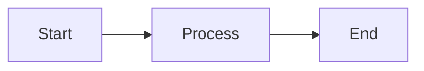

# Quikdown Editor Documentation

Quikdown Editor is a drop-in markdown editor control that provides a complete editing experience with live preview, bidirectional editing, and plugin support.

## Table of Contents

- [Installation](#installation)
- [Basic Usage](#basic-usage)
- [Configuration Options](#configuration-options)
- [API Reference](#api-reference)
- [View Modes](#view-modes)
- [Themes](#themes)
- [Host API](#host-api)
- [Plugin Integration](#plugin-integration)
- [Events and Callbacks](#events-and-callbacks)
- [Keyboard Shortcuts](#keyboard-shortcuts)
- [Examples](#examples)
- [Browser Support](#browser-support)

## Installation

### CDN

```html
<!-- ES Module -->
<script type="module">
  import QuikdownEditor from 'https://unpkg.com/quikdown/dist/quikdown_edit.esm.min.js';
</script>

<!-- UMD -->
<script src="https://unpkg.com/quikdown/dist/quikdown_edit.umd.min.js"></script>
```

### NPM

```bash
npm install quikdown
```

```javascript
// ES Module
import QuikdownEditor from 'quikdown/edit';

// CommonJS
const QuikdownEditor = require('quikdown/edit');
```

## Basic Usage

### Minimal Setup

```html
<!DOCTYPE html>
<html>
<head>
    <meta charset="UTF-8">
    <title>Quikdown Editor</title>
</head>
<body>
    <div id="editor" style="height: 400px;"></div>
    
    <script type="module">
        import QuikdownEditor from 'https://unpkg.com/quikdown/dist/quikdown_edit.esm.min.js';
        
        const editor = new QuikdownEditor('#editor');
        editor.setMarkdown('# Hello World\n\nStart editing!');
    </script>
</body>
</html>
```

### With Options

```javascript
const editor = new QuikdownEditor('#editor', {
    mode: 'split',           // View mode
    theme: 'dark',           // Theme
    showToolbar: true,       // Show toolbar
    lazy_linefeeds: false,   // Lazy linefeeds
    debounceDelay: 300,      // Debounce delay
    placeholder: 'Type here...',
    plugins: {
        highlightjs: true,   // Enable syntax highlighting
        mermaid: true        // Enable Mermaid diagrams
    }
});
```

## Configuration Options

| Option | Type | Default | Description |
|--------|------|---------|-------------|
| `mode` | string | `'split'` | Initial view mode: `'source'`, `'split'`, or `'preview'` |
| `theme` | string | `'auto'` | Theme: `'light'`, `'dark'`, or `'auto'` (follows system) |
| `showToolbar` | boolean | `true` | Show/hide the toolbar |
| `showRemoveHR` | boolean | `false` | Show/hide the "Remove HR" button in toolbar |
| `lazy_linefeeds` | boolean | `false` | Enable lazy linefeeds (single \n becomes `<br>`) |
| `debounceDelay` | number | `20` | Debounce delay in milliseconds for updates |
| `placeholder` | string | `'Start typing markdown...'` | Placeholder text for empty editor |
| `initialContent` | string | `''` | Initial markdown content |
| `plugins` | object | `{}` | Built-in plugin configuration (legacy — prefer `preloadFences`) |
| `preloadFences` | string \| array \| null | `null` | Preload fence libraries at construction (see below) |
| `customFences` | object | `{}` | Custom fence plugin handlers |
| `showLazyLinefeeds` | boolean | `false` | Show "Fix Linefeeds" button in toolbar |
| `showUndoRedo` | boolean | `false` | Show undo/redo buttons in toolbar |
| `undoStackSize` | number | `100` | Maximum undo states to keep |
| `onChange` | function | `null` | Callback when content changes |
| `enableComplexFences` | boolean | `true` | Enable complex fence rendering (mermaid, math, geojson, stl, etc.) |
| `inline_styles` | boolean | `false` | Embed styles inline instead of using class-based CSS |
| `onModeChange` | function | `null` | Callback when mode changes |
| `shortcuts` | boolean | `true` | Keyboard shortcuts for the editor that has focus (see [Keyboard Shortcuts](#keyboard-shortcuts)) |
| `mount` | string | `'replace'` | `'replace'` takes over the container; `'append'` adds the editor as a child and leaves the container's other content alone |
| `syncScroll` | boolean | `false` | Keep both panes at the same relative scroll position in split mode |
| `resolveImageSrc` | function | `null` | `(src, { alt, title }) => string` — rewrite image URLs for display only |
| `onRender` | function | `null` | `(previewElement) => void` — after every render of the preview |
| `onSelectionChange` | function | `null` | `({ start, end, text, pane, format }) => void` — when the selection changes in either pane |
| `onLinkClick` | function | `null` | `(href, event) => void` — a link in the rendered pane was clicked; navigation is cancelled unless the handler returns `true` |
| `assetBase` | string | `null` | Standalone build only: directory URL to load the offline basemap files from |

### Plugin Options (legacy)

```javascript
plugins: {
    highlightjs: boolean,  // Enable Highlight.js for syntax highlighting
    mermaid: boolean      // Enable Mermaid for diagrams
}
```

### `preloadFences` — fence library preloading

Each fence type that depends on an external library (Mermaid, MathJax, Leaflet
for GeoJSON, Three.js for STL, highlight.js for syntax highlighting) is
**lazy-loaded by default**. The first time the editor encounters a `mermaid`
fence, it fetches `mermaid.min.js` from the CDN; the first STL fence triggers
the Three.js download; and so on.

Lazy loading keeps the editor lightweight (~128 KB minified) but introduces a
small "loading…" delay the first time each fence type is rendered. For demo
pages, documentation sites, or apps where you know in advance which fence
types you'll need, you can preload those libraries at construction time:

```javascript
// Preload everything — first render of any fence is instant
new QuikdownEditor('#editor', {
  preloadFences: 'all'
});

// Preload a specific subset
new QuikdownEditor('#editor', {
  preloadFences: ['mermaid', 'math', 'highlightjs']
});

// Preload a custom library
new QuikdownEditor('#editor', {
  preloadFences: [
    'mermaid',
    { name: 'mermaid-extra', script: 'https://my-cdn/mermaid-extra.js', css: 'https://my-cdn/mermaid-extra.css' }
  ]
});

// Default — lazy load on demand
new QuikdownEditor('#editor', {});
```

**Recognized library names:**

| Name | Loads | Used by |
|---|---|---|
| `'highlightjs'` | highlight.js + GitHub theme | code-block syntax highlighting |
| `'mermaid'` | Mermaid.js | `mermaid` fence |
| `'math'` | MathJax (tex-svg) | `math`, `tex`, `latex`, `katex` fences |
| `'geojson'` | Leaflet + Leaflet CSS | `geojson` fence |
| `'stl'` | Three.js | `stl` fence |
| `'abc'` / `'music'` | ABCJS | `abc`, `music` fences (music notation) |
| `'vega'` | Vega + Vega-Lite + Vega-Embed | `vega`, `vega-lite`, `vegalite` fences (data visualization) |

**Trade-off**: preloading uses more upfront network (a few hundred KB) but
eliminates per-fence load delays. Developer's choice — the editor itself
stays the same size either way; only the optional fence renderers are affected.

**Recommendation**: leave `preloadFences` off for production apps that handle
arbitrary user content (lazy loading scales better), and set it to `'all'`
or a specific list for demos and apps where you know exactly which fence
types will appear.

## API Reference

### Constructor

```javascript
new QuikdownEditor(container, options?)
```

**Parameters:**
- `container` (string | HTMLElement): CSS selector or DOM element
- `options` (object): Configuration options

**Returns:** QuikdownEditor instance

### Methods

#### `setMarkdown(markdown, options?)`

Sets the markdown content.

```javascript
editor.setMarkdown('# New Content');

// Loading a different document: start with an empty undo history
editor.setMarkdown(text, { history: 'reset' });
```

`options.history` is `'keep'` (default: replace the text, leave the undo history as it is), `'reset'` (clear the history), or `'push'` (record the replaced text as an undo step). `options.source` is passed to `onChange` as `meta.source` (default `'api'`).

#### `getMarkdown()`

Returns the current markdown content.

```javascript
const markdown = editor.getMarkdown();
```

#### `getHTML()`

Returns the rendered HTML.

```javascript
const html = editor.getHTML();
```

#### `setMode(mode)`

Changes the view mode.

```javascript
editor.setMode('preview'); // 'source', 'split', or 'preview'
```

#### `removeHR()`

Removes all horizontal rules (---) from the markdown content.

```javascript
editor.removeHR();
```

#### `copyRendered()`

Copies the rendered HTML content to clipboard as rich text. Converts math equations to images and GeoJSON maps to static images for better paste compatibility.

```javascript
editor.copyRendered();
```

#### `setLazyLinefeeds(enabled)`

Enables or disables lazy linefeeds (single \n becomes `<br>`).

```javascript
editor.setLazyLinefeeds(true);
```

#### `setDebounceDelay(delay)`

Sets the debounce delay for input updates (in milliseconds). Use 0 for instant updates.

```javascript
editor.setDebounceDelay(0); // Instant updates
editor.setDebounceDelay(300); // Default
```

#### `undo()`

Undoes the last edit.

```javascript
editor.undo();
```

#### `redo()`

Redoes the last undone edit.

```javascript
editor.redo();
```

#### `canUndo()`

Returns `true` if there is an edit to undo.

```javascript
if (editor.canUndo()) {
    editor.undo();
}
```

#### `canRedo()`

Returns `true` if there is an edit to redo.

```javascript
if (editor.canRedo()) {
    editor.redo();
}
```

#### `clearHistory()`

Clears the undo/redo history.

```javascript
editor.clearHistory();
```

#### `getLazyLinefeeds()`

Returns the current lazy linefeeds state (`true` or `false`).

```javascript
const isLazy = editor.getLazyLinefeeds();
```

#### `convertLazyLinefeeds()`

Converts single newlines in the current content to paragraph breaks (`\n\n`). Useful for normalizing content that was authored with lazy linefeeds enabled.

```javascript
editor.convertLazyLinefeeds();
```

#### `getMode()`

Returns the current view mode: `'source'`, `'split'`, or `'preview'`.

#### `setSplitPane(pane)` / `getSplitPane()`

On a portrait viewport up to 720px wide, split mode shows one pane at a time and the toolbar has a Preview/Source button to switch. These methods do the same from code. `pane` is `'source'` or `'preview'`. On other viewports both panes are visible and the setting has no visible effect. `setMode()` resets it to `'source'`.

```javascript
editor.setMode('split');
editor.setSplitPane('preview');
editor.getSplitPane(); // 'preview'
```

#### `setTheme(theme)` / `getTheme()`

Sets the colour theme: `'light'`, `'dark'`, or `'auto'` (follow the system setting). `getTheme()` returns the configured value.

```javascript
editor.setTheme('dark');
```

#### `copy(type)`

Copies the document to the clipboard as text. `type` is `'markdown'` or `'html'`. Returns a promise. These are the toolbar's Copy MD and Copy HTML buttons; `copyRendered()` is the Copy Rendered button.

```javascript
await editor.copy('markdown');
```

#### `setAllowUnsafeHTML(mode)` / `getAllowUnsafeHTML()` / `cycleAllowUnsafeHTML()`

Sets how raw HTML in the markdown is handled, and re-renders. `mode` is `false` (escape all HTML, the default), `'limited'` (allow a small set of safe tags), or `true` (pass HTML through). `cycleAllowUnsafeHTML()` steps to the next mode, as the optional toolbar button does (`showAllowUnsafeHTML: true`).

```javascript
editor.setAllowUnsafeHTML('limited');
editor.getAllowUnsafeHTML(); // 'limited'
```

#### `getDebounceDelay()`

Returns the current debounce delay in milliseconds.

#### `flush()`

Applies an edit that is still waiting on the debounce timer. `getMarkdown()`, `getHTML()` and every method that reads or changes the document call it for you, so their results always include the latest keystroke.

#### `destroy()`

Removes the editor's event listeners, timers and DOM. Safe to call more than once. Other editors on the page are not affected.

```javascript
editor.destroy();
```

Selection, formatting, history, scroll and line-mapping methods are described under [Host API](#host-api).

### Static Methods

#### `QuikdownEditor.convertLazyLinefeeds(markdown)`

Converts single newlines to paragraph breaks in the given markdown string. Returns the converted string.

```javascript
const normalized = QuikdownEditor.convertLazyLinefeeds('Line one\nLine two');
// "Line one\n\nLine two"
```

#### `QuikdownEditor.removeHRFromMarkdown(markdown)`

Removes all horizontal rules (`---`) from the given markdown string. Returns the cleaned string.

```javascript
const cleaned = QuikdownEditor.removeHRFromMarkdown('Some text\n\n---\n\nMore text');
```

### Properties

#### `markdown`

Get or set markdown content.

```javascript
// Get
const content = editor.markdown;

// Set
editor.markdown = '# New Content';
```

#### `html` (read-only)

Get the rendered HTML.

```javascript
const html = editor.html;
```

#### `mode` (read-only)

Get the current view mode.

```javascript
const currentMode = editor.mode; // 'source', 'split', or 'preview'
```

## View Modes

### Source Mode

Shows only the markdown source editor.

```javascript
editor.setMode('source');
```

### Split Mode

Shows markdown source and preview side-by-side.

```javascript
editor.setMode('split');
```

### Preview Mode

Shows only the rendered preview (still editable).

```javascript
editor.setMode('preview');
```

## Themes

### Light Theme

```javascript
const editor = new QuikdownEditor('#editor', {
    theme: 'light'
});
```

### Dark Theme

```javascript
const editor = new QuikdownEditor('#editor', {
    theme: 'dark'
});
```

### Auto Theme

Follows system preference.

```javascript
const editor = new QuikdownEditor('#editor', {
    theme: 'auto'  // Default
});
```

## Styling the Editor Preview

The editor ships with intentionally plain preview styles — black text (or
light text in dark mode), browser-default heading sizes, no decorative
borders. This means it blends into any parent page without clashing.

To customise the preview, add CSS rules that target `.qde-preview` in your
own stylesheet. The editor's built-in rules have normal specificity so a
single-class selector in a `<style>` tag or external sheet is enough to
override them — no `!important` needed.

```css
/* Example: branded headings with an accent underline */
.qde-preview h1 {
  color: #6c47b8;
  border-bottom: 2px solid #e0d4f5;
  padding-bottom: 0.3em;
}

/* Tighter paragraph spacing */
.qde-preview p {
  margin: 0.25em 0;
}

/* Custom code block look */
.qde-preview pre {
  background: #1e1e2e;
  color: #cdd6f4;
  border-radius: 8px;
  padding: 1em;
}
```

If the editor is embedded on a page whose own CSS targets bare element
selectors (`h1`, `p`, `pre`, etc.), those rules will bleed into the
preview. Either scope your page styles (`.my-page h1 { ... }`) or add
reset overrides on `.qde-preview` elements.

## Headless and Minimal UI Usage

### Headless Mode (No UI)

You can use QuikdownEditor programmatically without any UI:

```javascript
// Create editor without toolbar
const editor = new QuikdownEditor('#hidden-container', {
    showToolbar: false,
    mode: 'source'  // Use source mode for direct text manipulation
});

// Programmatically set content
editor.setMarkdown('# My Document');

// Get rendered HTML
const html = editor.getHTML();

// Convert and transform markdown
const processedMarkdown = editor.getMarkdown();
```

### Minimal UI

For a minimal interface with just essential buttons:

```javascript
const editor = new QuikdownEditor('#editor', {
    showToolbar: true,
    showRemoveHR: false,  // Hide special buttons
    mode: 'split',
    theme: 'light'
});
```

### Custom Toolbar

You can hide the built-in toolbar and create your own:

```javascript
// Create editor without toolbar
const editor = new QuikdownEditor('#editor', {
    showToolbar: false
});

// Add custom buttons
document.getElementById('my-preview-btn').onclick = () => {
    editor.setMode('preview');
};

document.getElementById('my-copy-btn').onclick = () => {
    editor.copyRendered();
};
```

### Toolbar buttons and their API calls

Each built-in toolbar button and keyboard shortcut calls a public method, so a host that hides the toolbar can do the same things from its own controls.

| Toolbar button or key | API |
|---|---|
| Source / Split / Rendered, Cmd/Ctrl+1/2/3 | `setMode('source' \| 'split' \| 'preview')`, `getMode()` |
| Preview / Source (narrow portrait viewport, split mode) | `setSplitPane('source' \| 'preview')`, `getSplitPane()` |
| Undo, Redo, Cmd/Ctrl+Z, Cmd/Ctrl+Shift+Z, Cmd/Ctrl+Y | `undo()`, `redo()`, `canUndo()`, `canRedo()` |
| Copy MD | `copy('markdown')` |
| Copy HTML | `copy('html')` |
| Copy Rendered | `copyRendered()` |
| Remove HR | `removeHR()` |
| Fix Linefeeds | `convertLazyLinefeeds()` |
| HTML mode button | `cycleAllowUnsafeHTML()`, `setAllowUnsafeHTML(mode)`, `getAllowUnsafeHTML()` |
| Cmd/Ctrl+B, Cmd/Ctrl+I | `format('bold')`, `format('italic')` |
| Tab, Shift+Tab in a list item | `format('indent')`, `format('outdent')` |

The theme has no toolbar button: use `setTheme()` and `getTheme()`.

## Host API

For applications that run the editor headless (`showToolbar: false`) and draw their own controls. Everything here works the same in the source pane and the rendered pane, and in Chromium, Firefox and WebKit: formatting and selection are done on the markdown text, not with `document.execCommand`.

Offsets are character offsets into the markdown returned by `getMarkdown()`. Line numbers are zero-based.

### Selection and edits

| Method | Returns | Description |
|--------|---------|-------------|
| `getSelection()` | `{ start, end, text, pane }` | The selection in whichever pane the user is in. A caret has `start === end`. |
| `setSelection(start, end?, pane?)` | `{ start, end }` | Select a range, or place the caret. In the rendered pane the matching rendered text is selected. |
| `insertText(text)` | `{ start, end }` | Insert at the caret, replacing the selection. |
| `replaceRange(start, end, text, select?)` | `{ start, end }` | Replace a range. `select: true` selects the inserted text. |
| `focus(pane?)` | | Move keyboard focus into the editor. |
| `getFocusedPane()` | `'source'` \| `'preview'` \| `null` | The pane that has keyboard focus. |

```javascript
// Insert a link to a pasted image at the caret
editor.insertText(``);

// Find and replace
const at = editor.getMarkdown().indexOf('colour');
if (at !== -1) editor.replaceRange(at, at + 6, 'color', true);
```

"The pane the user is in" is the focused pane, or the pane they last clicked or typed in. That means a button in your own toolbar can call these methods even though clicking it took focus away from the editor.

Edits made through these methods go through the same path as typing: they update the other pane, add one undo step, and call `onChange`.

In the rendered pane, a selection end that falls inside markdown syntax with no rendered text of its own (the `**` of bold, a link target) is placed at the nearest rendered position.

### Formatting

```javascript
editor.format('bold');                      // toggle
editor.format('link', 'https://example.com');
editor.format('h2');
editor.format('table', { rows: 3, cols: 2 });
```

| Command | Value | Effect |
|---------|-------|--------|
| `bold`, `italic`, `strike`, `code` | | Toggle the inline style on the selection, or on the word under the caret |
| `link` | URL; `null` removes | Link the selection, change the link under it, or remove it |
| `h1` … `h6` | | Set the heading level; the same level again clears it |
| `heading` | `0`–`6` | Set the heading level; `0` clears |
| `paragraph` | | Remove heading, list and quote markers |
| `ul`, `ol`, `task` | | Toggle a bullet, numbered or task list on the selected lines |
| `quote` | | Add or remove one blockquote level |
| `codeblock` | language | Wrap the selected lines in a fence, or unwrap |
| `hr` | | Insert a horizontal rule after the current line |
| `table` | `{ rows, cols }` | Insert a table template |
| `indent`, `outdent` | | Shift the selected lines by two spaces |

`format()` returns `false` for a command it does not know.

`getFormatState()` describes the formatting at the caret, for pressed states in a toolbar:

```javascript
editor.getFormatState();
// { bold, italic, strike, code, link, heading: 0-6, list: 'ul'|'ol'|'task'|null, quote, codeblock }
```

The same transforms are available without an editor:

```javascript
QuikdownEditor.formatMarkdown('some text', 5, 9, 'bold');
// { markdown: 'some **text**', start: 7, end: 11 }
QuikdownEditor.getFormatState('some **text**', 8, 8).bold;   // true
QuikdownEditor.FORMAT_COMMANDS;                               // every command name
```

### Events

```javascript
const editor = new QuikdownEditor('#editor', {
    onChange(markdown, html, meta) {
        if (meta.source !== 'api') markDirty();
    },
    onSelectionChange({ start, end, text, pane, format }) {
        boldButton.classList.toggle('pressed', format.bold);
    },
    onRender(preview) { /* the preview element was just re-rendered */ },
    onLinkClick(href, event) { openInSystemBrowser(href); }
});
```

`meta.source` says where a change came from:

| Value | Cause |
|-------|-------|
| `'user'` | Typing in either pane |
| `'api'` | `setMarkdown()`, `initialContent`, and option setters that re-render |
| `'format'` | `format()` and the formatting shortcuts |
| `'edit'` | `insertText()` and `replaceRange()` |
| `'undo'`, `'redo'` | History |
| anything else | The string passed as `setMarkdown(md, { source })` |

When `onLinkClick` is set, clicking a link in the rendered pane calls it and cancels navigation. Return `true` from the handler to let the browser follow the link.

### History per document

`setMarkdown()` keeps the undo history unless told otherwise, so a host that shows several documents in one editor should save and restore the history when it switches:

```javascript
function switchTo(next) {
    current.text = editor.getMarkdown();
    current.history = editor.getHistory();          // { undo: [...], redo: [...] }
    editor.setMarkdown(next.text, { history: 'reset' });
    editor.setHistory(next.history);                // undefined → empty
    current = next;
}
```

### Scroll and line mapping

| Method | Description |
|--------|-------------|
| `getScroll()` | `{ source, preview }` scroll positions |
| `setScroll({ source, preview })` | Restore them; either field may be omitted |
| `scrollToLine(line, pane?)` | Scroll a source line into view in one pane or both; returns the preview block it scrolled to |
| `lineOf(element)` | Source line of an element in the rendered pane, or `-1` |

```javascript
// Outline: jump to a heading
editor.scrollToLine(heading.line);

// Which source line was clicked in the preview?
preview.addEventListener('click', e => console.log(editor.lineOf(e.target)));
```

`syncScroll: true` keeps the two panes at the same relative position in split mode. It is proportional, not line-accurate.

The line mapping is computed from the rendered preview when it is asked for; the HTML does not carry line attributes.

`QuikdownEditor.mapOffset(from, to, offset)` translates an offset in one version of a document to the matching offset in another, for keeping the caret when a file is reloaded after changing on disk.

### Images

`resolveImageSrc` rewrites image URLs for display, for hosts where a relative path cannot load from the page's origin:

```javascript
new QuikdownEditor('#editor', {
    resolveImageSrc: (src, { alt, title }) =>
        /^[a-z]+:/i.test(src) ? src : `asset://${documentDir}/${src}`
});
```

The markdown and `getHTML()` keep the original URL. Return nothing to leave an image as it is.

### Mounting

By default the editor takes over the container: it empties it and uses it as its root element. Classes the host put on the container are kept. With `mount: 'append'` the editor adds its own root element as a child and removes only that element on `destroy()`. `editor.host` is the element you passed in; `editor.container` is the editor's root.

### Theming with CSS variables

The built-in stylesheet reads these custom properties, falling back to its own defaults. Set them on the container or any ancestor:

```css
#my-editor {
  --qde-bg: #fdf6e3;
  --qde-fg: #333;
  --qde-border: #d8cfb4;
  --qde-font: Georgia, serif;
  --qde-preview-font-size: 18px;
}
#my-editor.qde-dark { --qde-bg: #1b1b1b; --qde-fg: #ddd; }
```

| Variable | Applies to |
|----------|-----------|
| `--qde-bg`, `--qde-fg`, `--qde-border`, `--qde-radius` | Editor frame |
| `--qde-padding` | Padding of both panes |
| `--qde-font`, `--qde-preview-font-size`, `--qde-line-height`, `--qde-preview-bg`, `--qde-preview-fg` | Rendered pane |
| `--qde-source-font`, `--qde-source-font-size`, `--qde-source-line-height`, `--qde-source-bg`, `--qde-source-fg` | Source pane |
| `--qde-font-size` | Both panes, when the pane-specific size is not set |
| `--qde-code-font`, `--qde-code-bg`, `--qde-code-fg`, `--qde-inline-code-bg` | Code blocks and inline code |
| `--qde-table-border`, `--qde-table-header-bg`, `--qde-table-stripe-bg` | Tables |
| `--qde-toolbar-bg`, `--qde-btn-bg`, `--qde-btn-fg`, `--qde-btn-border`, `--qde-btn-hover-bg`, `--qde-btn-hover-border`, `--qde-accent`, `--qde-accent-fg`, `--qde-accent-border` | Built-in toolbar |

A variable you set applies in both light and dark themes; scope it with `.qde-dark` (the class the editor puts on its root in dark mode) to give the two themes different values.

### Several editors on one page

Each editor keeps its own state, listeners and timers. Keyboard shortcuts act only on the editor that has focus, and leave other inputs on the page alone. `destroy()` removes everything an editor added; the shared stylesheet is removed when the last editor on the page is destroyed. This suits interfaces that create and destroy many editors, such as one per chat message:

```javascript
const turn = new QuikdownEditor(messageEl, { showToolbar: false, mode: 'preview' });
await turn.setMarkdown(text);     // call again as the message streams in
// later
turn.destroy();
```

### Standalone build from npm

The standalone bundle (every fence renderer included, no CDN requests) is exported as `quikdown/edit-standalone`, with the same TypeScript types as `quikdown/edit`:

```javascript
import QuikdownEditor from 'quikdown/edit-standalone';
```

It is an ESM and UMD browser bundle; there is no CommonJS build. The offline basemap files (`basemap_*.topojson`) are fetched from the bundle's own directory at run time. If your bundler moves the JavaScript, copy those two files somewhere you serve and pass that directory as `assetBase`.

## Plugin Integration

### Built-in Fence Types (Lazy Loaded)

The editor includes built-in handlers for common fence types that automatically load required libraries:

| Fence Type | Description | Library | Auto-Loaded |
|------------|-------------|---------|-------------|
| `svg` | Inline SVG rendering | None | N/A |
| `html` | Safe HTML rendering | DOMPurify | Yes |
| `math`, `katex`, `tex`, `latex` | Math equations | MathJax v3 | Yes |
| `csv` | Comma-separated values table | None | N/A |
| `psv` | Pipe-separated values table | None | N/A |
| `tsv` | Tab-separated values table | None | N/A |
| `json`, `json5` | Syntax highlighted JSON | None/Highlight.js | Optional |
| `geojson` | Interactive maps from GeoJSON | Leaflet | Yes |
| `stl` | 3D model viewer | Three.js | Yes |
| `mermaid` | Diagrams | Mermaid | Yes |
| `abc`, `music` | Music notation (ABC format) | ABCJS | Yes |
| `vega`, `vega-lite`, `vegalite` | Data visualization charts | Vega + Vega-Lite + Vega-Embed | Yes |

### Highlight.js

Enable syntax highlighting for code blocks:

```javascript
const editor = new QuikdownEditor('#editor', {
    plugins: {
        highlightjs: true
    }
});
```

The editor will automatically load Highlight.js from CDN if not already present.

### Mermaid

Enable Mermaid diagram rendering:

```javascript
const editor = new QuikdownEditor('#editor', {
    plugins: {
        mermaid: true
    }
});
```

Use in markdown:

````markdown

````

### Built-in Fence Examples

#### SVG Rendering

````markdown
```svg
<svg width="100" height="100">
    <circle cx="50" cy="50" r="40" fill="blue"/>
</svg>
```
````

#### Safe HTML (with DOMPurify)

````markdown
```html
<div style="color: blue;">
    <h3>Safe HTML</h3>
    <p>Scripts and event handlers are removed</p>
</div>
```
````

#### Math Equations (MathJax v3)

Rendering uses **MathJax v3** (CDN). The fence language `katex` is still accepted for backward compatibility and routes to MathJax — quikdown originally experimented with KaTeX before switching (see `docs/release-notes.md` v1.2.x).

````markdown
```math
E = mc^2
```

```katex
\\int_{0}^{\\infty} e^{-x^2} dx = \\frac{\\sqrt{\\pi}}{2}
```
````

#### Data Tables

````markdown
```csv
Name,Age,City
Alice,30,New York
Bob,25,London
```

```psv
Name|Age|City
Alice|30|New York
Bob|25|London
```
````

#### JSON with Syntax Highlighting

````markdown
```json
{
  "name": "QuikDown",
  "version": "1.2.22",
  "features": ["markdown", "preview", "plugins"]
}
```
````

#### Music Notation (ABC)

Renders sheet music from [ABC notation](https://abcnotation.com/). Uses the ABCJS library (lazy-loaded from CDN). Both `abc` and `music` fence names are accepted.

````markdown
```abc
X:1
T:Ode to Joy
M:4/4
L:1/4
K:C
E E F G | G F E D | C C D E | E D/2D/2 D2 |
```
````

ABC notation headers: `X:` reference number, `T:` title, `M:` meter, `L:` default note length, `K:` key. Notes use letter names (`C D E F G A B c d e`), with `|` for bar lines and `/2` for half duration.

#### Data Visualization (Vega / Vega-Lite)

Renders interactive charts from [Vega](https://vega.github.io/vega/) or [Vega-Lite](https://vega.github.io/vega-lite/) JSON specs. Accepts `vega`, `vega-lite`, or `vegalite` as the fence language. Vega, Vega-Lite, and Vega-Embed are all lazy-loaded from CDN.

````markdown
```vega-lite
{
  "$schema": "https://vega.github.io/schema/vega-lite/v5.json",
  "data": {
    "values": [
      {"category": "A", "value": 28},
      {"category": "B", "value": 55},
      {"category": "C", "value": 43}
    ]
  },
  "mark": "bar",
  "encoding": {
    "x": {"field": "category", "type": "nominal"},
    "y": {"field": "value", "type": "quantitative"}
  }
}
```
````

Data must be provided inline via `"values"`. When `allowExternalFetch` is `false` (standalone/offline mode), specs that reference external `"url"` data sources will show a warning instead of fetching.

If the `$schema` field is omitted on a `vega-lite` or `vegalite` fence, the editor auto-injects the Vega-Lite v5 schema.

### Custom Fence Plugins

Provide custom handlers for specific fence languages using the `customFences` option:

```javascript
const editor = new QuikdownEditor('#editor', {
    customFences: {
        // Each key is a language identifier
        'custom': (code, language) => {
            return `<div class="custom">${code}</div>`;
        },
        'math': (code, language) => {
            // Handle math blocks
            return `<div class="math">$$${code}$$</div>`;
        }
    }
});
```

#### MathJax Integration

```javascript
const editor = new QuikdownEditor('#editor', {
    customFences: {
        'math': (code, lang) => {
            if (window.MathJax) {
                const id = `math-${Date.now()}`;
                const html = `<div id="${id}" class="math-block">\\[${code}\\]</div>`;
                
                // Tell MathJax to render after DOM insertion
                setTimeout(() => {
                    MathJax.typesetPromise([document.getElementById(id)]);
                }, 0);
                
                return html;
            }
            return `<pre class="math-source">${code}</pre>`;
        }
    }
});
```

#### KaTeX Integration (legacy / customFences only)

> **Note:** Built-in editor fences use MathJax, not KaTeX. This example is for apps that bring their own KaTeX via `customFences` — not the default try-it or CDN editor path.

```javascript
const editor = new QuikdownEditor('#editor', {
    customFences: {
        'math': (code, lang) => {
            if (window.katex) {
                try {
                    return katex.renderToString(code, {
                        displayMode: true,
                        throwOnError: false
                    });
                } catch (err) {
                    return `<div class="math-error">Error: ${err.message}</div>`;
                }
            }
            return `<pre>${code}</pre>`;
        }
    }
});
```

#### Multiple Custom Plugins

```javascript
const editor = new QuikdownEditor('#editor', {
    customFences: {
        // Math rendering
        'math': (code, lang) => {
            // Your math rendering logic
        },
        
        // PlantUML diagrams
        'plantuml': (code, lang) => {
            const encoded = plantumlEncoder.encode(code);
            return ``;
        },
        
        // JSON visualization
        'json': (code, lang) => {
            try {
                const data = JSON.parse(code);
                return `<pre class="json">${JSON.stringify(data, null, 2)}</pre>`;
            } catch (err) {
                return `<pre class="error">Invalid JSON: ${err.message}</pre>`;
            }
        },
        
        // Chart rendering
        'chart': (code, lang) => {
            try {
                const config = JSON.parse(code);
                return renderChart(config); // Your chart rendering function
            } catch (err) {
                return `<pre>Invalid chart config: ${err.message}</pre>`;
            }
        }
    },
    
    // You can still use built-in plugins alongside custom ones
    plugins: {
        highlightjs: true,  // For other code blocks
        mermaid: true      // Built-in mermaid support
    }
});
```

**Note:** Custom fences are checked first, before built-in plugins. If a custom fence returns `undefined`, it falls back to built-in behavior.

## Events and Callbacks

### onChange

Called when content changes:

```javascript
const editor = new QuikdownEditor('#editor', {
    onChange: (markdown, html, meta) => {
        console.log('Markdown:', markdown);
        console.log('HTML:', html);
        console.log('Changed by:', meta.source);   // 'user', 'api', 'format', 'edit', 'undo', 'redo'
    }
});
```

`onRender`, `onSelectionChange` and `onLinkClick` are described under [Host API](#events).

### onModeChange

Called when view mode changes:

```javascript
const editor = new QuikdownEditor('#editor', {
    onModeChange: (mode) => {
        console.log('Mode changed to:', mode);
    }
});
```

## Keyboard Shortcuts

| Shortcut | Action |
|----------|--------|
| `Ctrl/Cmd + Z` | Undo |
| `Ctrl/Cmd + Shift + Z`, `Ctrl/Cmd + Y` | Redo |
| `Ctrl/Cmd + 1` | Switch to source mode |
| `Ctrl/Cmd + 2` | Switch to split mode |
| `Ctrl/Cmd + 3` | Switch to preview mode |
| `Ctrl/Cmd + B` | Bold (either pane) |
| `Ctrl/Cmd + I` | Italic (either pane) |
| `Tab` / `Shift + Tab` | Indent / outdent the list item under the caret; outside a list, Tab keeps its normal meaning |

Shortcuts act on the editor that has keyboard focus. Set `shortcuts: false` to turn them all off.

## Examples

### Complete Example with All Features

```html
<!DOCTYPE html>
<html>
<head>
    <meta charset="UTF-8">
    <title>Quikdown Editor - Full Example</title>
</head>
<body>
    <div id="editor" style="height: 500px;"></div>
    <div id="status"></div>
    
    <script type="module">
        import QuikdownEditor from 'https://unpkg.com/quikdown/dist/quikdown_edit.esm.min.js';
        
        const editor = new QuikdownEditor('#editor', {
            mode: 'split',
            theme: 'auto',
            showToolbar: true,
            lazy_linefeeds: false,
            debounceDelay: 300,
            placeholder: 'Start typing markdown...',
            initialContent: '# Welcome to Quikdown Editor\n\n' +
                          '## Features\n\n' +
                          '- **Bold** and *italic* text\n' +
                          '- [Links](https://example.com)\n' +
                          '- `Code blocks`\n\n' +
                          '```javascript\n' +
                          'console.log("Hello World");\n' +
                          '```\n',
            plugins: {
                highlightjs: true,
                mermaid: true
            },
            onChange: (markdown, html) => {
                document.getElementById('status').textContent = 
                    `Characters: ${markdown.length}`;
            },
            onModeChange: (mode) => {
                console.log('Mode changed to:', mode);
            }
        });
        
        // Programmatic control
        document.addEventListener('keydown', (e) => {
            if (e.ctrlKey && e.key === 's') {
                e.preventDefault();
                const content = editor.getMarkdown();
                console.log('Saving:', content);
                // Save to server or localStorage
            }
        });
    </script>
</body>
</html>
```

### Integration with Form

```javascript
const form = document.getElementById('myForm');
const editor = new QuikdownEditor('#editor');

form.addEventListener('submit', (e) => {
    e.preventDefault();
    
    const formData = new FormData(form);
    formData.append('content', editor.getMarkdown());
    
    fetch('/api/save', {
        method: 'POST',
        body: formData
    });
});
```

### Multiple Editors

```javascript
const editor1 = new QuikdownEditor('#editor1', {
    mode: 'source',
    theme: 'light'
});

const editor2 = new QuikdownEditor('#editor2', {
    mode: 'preview',
    theme: 'dark'
});

// Sync content between editors
editor1.onChange = (markdown) => {
    editor2.setMarkdown(markdown);
};
```

### With Custom Styling

```html
<style>
    #custom-editor {
        border: 2px solid #007bff;
        border-radius: 8px;
        box-shadow: 0 4px 6px rgba(0,0,0,0.1);
    }
    
    #custom-editor .qde-toolbar {
        background: linear-gradient(to right, #007bff, #0056b3);
    }
    
    #custom-editor .qde-btn {
        background: white;
        color: #007bff;
    }
</style>

<div id="custom-editor" style="height: 400px;"></div>

<script type="module">
    import QuikdownEditor from 'https://unpkg.com/quikdown/dist/quikdown_edit.esm.min.js';
    
    const editor = new QuikdownEditor('#custom-editor', {
        mode: 'split',
        theme: 'light'
    });
</script>
```

### Complete Example with MathJax

```html
<!DOCTYPE html>
<html>
<head>
    <meta charset="UTF-8">
    <title>Quikdown Editor with MathJax</title>
    <!-- Load MathJax -->
    <script src="https://polyfill.io/v3/polyfill.min.js?features=es6"></script>
    <script id="MathJax-script" async src="https://cdn.jsdelivr.net/npm/mathjax@3/es5/tex-mml-chtml.js"></script>
    <style>
        body { margin: 20px; font-family: Arial, sans-serif; }
        #editor { height: 500px; border: 1px solid #ddd; }
        .math-block { margin: 1em 0; }
    </style>
</head>
<body>
    <h1>Quikdown Editor with Math Support</h1>
    <div id="editor"></div>
    
    <script type="module">
        import QuikdownEditor from 'https://unpkg.com/quikdown/dist/quikdown_edit.esm.min.js';
        
        // Wait for MathJax to load
        window.MathJax = {
            tex: {
                inlineMath: [['$', '$'], ['\\(', '\\)']],
                displayMath: [['$$', '$$'], ['\\[', '\\]']]
            }
        };
        
        const editor = new QuikdownEditor('#editor', {
            mode: 'split',
            showToolbar: true,
            customFences: {
                // Handle ```math blocks
                'math': (code, lang) => {
                    const id = `math-${Date.now()}-${Math.random().toString(36).substr(2, 9)}`;
                    
                    // Schedule MathJax rendering
                    setTimeout(() => {
                        const element = document.getElementById(id);
                        if (element && window.MathJax) {
                            MathJax.typesetPromise([element]).catch(err => {
                                console.error('MathJax error:', err);
                            });
                        }
                    }, 10);
                    
                    return `<div id="${id}" class="math-block">\\[${code}\\]</div>`;
                },
                
                // Handle ```latex blocks
                'latex': (code, lang) => {
                    const id = `latex-${Date.now()}-${Math.random().toString(36).substr(2, 9)}`;
                    
                    setTimeout(() => {
                        const element = document.getElementById(id);
                        if (element && window.MathJax) {
                            MathJax.typesetPromise([element]);
                        }
                    }, 10);
                    
                    return `<div id="${id}" class="latex-block">$$${code}$$</div>`;
                }
            },
            
            // Still use highlight.js for other code blocks
            plugins: {
                highlightjs: true
            },
            
            initialContent: `# Math Examples

## Inline Math

This is inline math: $E = mc^2$ (requires inline math processing in your markdown)

## Math Blocks

\`\`\`math
\\int_{0}^{\\infty} e^{-x^2} dx = \\frac{\\sqrt{\\pi}}{2}
\`\`\`

## LaTeX Block

\`\`\`latex
\\begin{align}
\\nabla \\times \\vec{\\mathbf{B}} -\\, \\frac1c\\, \\frac{\\partial\\vec{\\mathbf{E}}}{\\partial t} &= \\frac{4\\pi}{c}\\vec{\\mathbf{j}} \\\\
\\nabla \\cdot \\vec{\\mathbf{E}} &= 4 \\pi \\rho \\\\
\\nabla \\times \\vec{\\mathbf{E}}\\, +\\, \\frac1c\\, \\frac{\\partial\\vec{\\mathbf{B}}}{\\partial t} &= \\vec{\\mathbf{0}} \\\\
\\nabla \\cdot \\vec{\\mathbf{B}} &= 0
\\end{align}
\`\`\`

## Regular Code Block

\`\`\`javascript
// This still gets syntax highlighted
function fibonacci(n) {
    if (n <= 1) return n;
    return fibonacci(n - 1) + fibonacci(n - 2);
}
\`\`\`
`
        });
    </script>
</body>
</html>
```

## Browser Support

Quikdown Editor supports all modern browsers:

- Chrome/Edge 88+
- Firefox 78+
- Safari 14+
- iOS Safari 14+
- Chrome for Android 88+

For older browsers, use the UMD build which includes necessary polyfills.

## Troubleshooting

### Editor not appearing

Ensure the container element has a defined height:

```css
#editor {
    height: 400px; /* or min-height */
}
```

### Plugins not loading

The editor automatically loads plugins from CDN. If you're behind a firewall or offline, load them manually:

```html
<!-- Load before creating editor -->
<link rel="stylesheet" href="path/to/highlight.css">
<script src="path/to/highlight.js"></script>
<script src="path/to/mermaid.js"></script>
```

### Content not syncing

Ensure you're using the bidirectional build of quikdown:

```javascript
// The editor automatically uses quikdown_bd for bidirectional support
// This is built into quikdown_edit.js
```

## Advanced Usage

### Custom Toolbar Actions

```javascript
// After editor creation
const toolbar = editor.container.querySelector('.qde-toolbar');

const customBtn = document.createElement('button');
customBtn.className = 'qde-btn';
customBtn.textContent = 'Export';
customBtn.onclick = () => {
    const blob = new Blob([editor.getMarkdown()], { type: 'text/markdown' });
    const url = URL.createObjectURL(blob);
    const a = document.createElement('a');
    a.href = url;
    a.download = 'document.md';
    a.click();
};

toolbar.appendChild(customBtn);
```

### Programmatic Content Manipulation

```javascript
// Insert at cursor position
const insertAtCursor = (text) => {
    const textarea = editor.sourceTextarea;
    const start = textarea.selectionStart;
    const end = textarea.selectionEnd;
    const value = textarea.value;
    
    textarea.value = value.substring(0, start) + text + value.substring(end);
    textarea.selectionStart = textarea.selectionEnd = start + text.length;
    
    // Trigger update
    textarea.dispatchEvent(new Event('input'));
};

// Usage
insertAtCursor('**bold text**');
```

## Performance Tips

1. **Debouncing**: Adjust `debounceDelay` for large documents
2. **Lazy Loading**: Plugins are loaded on-demand
3. **Mode Selection**: Use source mode for large documents to improve performance
4. **Memory Management**: Call `destroy()` when removing editors

## License

BSD 2-Clause License - see [LICENSE.txt](../LICENSE.txt) for details.